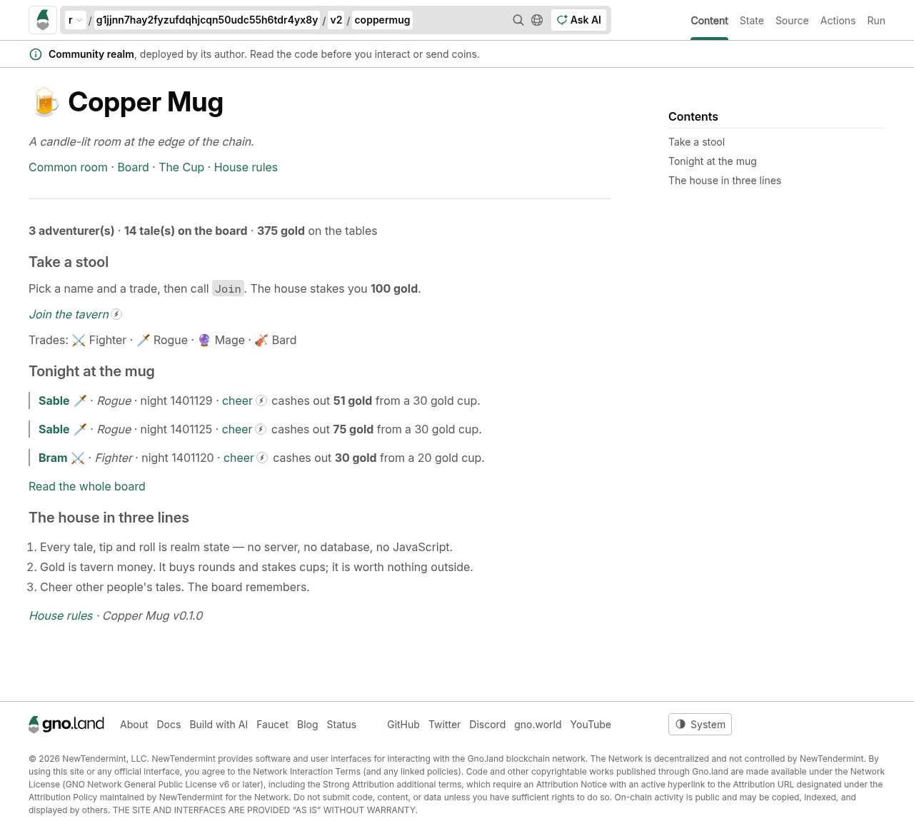

# 🍺 Copper Mug

An on-chain social tavern for [Gno.land](https://gno.land): a common room where
adventurers take a seat, talk, tip each other, buy the room a round, and gamble
their gold in a push-your-luck dice game called **the Cup**.

Every post, tip, cheer and dice roll is realm state. The entire front end is the
realm's `Render` output, so the app runs in gnoweb with no server, no database
and no JavaScript.

**Live on the Gno.land testnet:**
<https://onyx.testnets.gno.land/r/g1jjnn7hay2fyzufdqhjcqn50udc55h6tdr4yx8y/v2/coppermug>

> Gold is tavern money minted by the realm. It has no monetary value and cannot
> leave the realm.



*The live realm as rendered by gnoweb: stats, tonight's tales, and open cups.*

---

## What is here

| Path | What it does |
|---|---|
| `tavern.gno` | State, types, caller checks, validation helpers, house randomness |
| `social.gno` | `Join`, `Say`, `Tip`, `Cheer`, `BuyRound` |
| `game.gno` | `OpenCup`, `Roll`, `Hold` |
| `render.gno` | The whole UI: home, feed, board, cup, profiles, rules |
| `tavern_test.gno` | Unit tests for behaviour and every rejection path |

The realm renders six routes:

| Route | Page |
|---|---|
| `/r/<pkg>` | Home: stats, tonight's tales, open cups |
| `/r/<pkg>:feed` | The common room |
| `/r/<pkg>:board` | Richest, most renowned, biggest pots |
| `/r/<pkg>:cup` | Rules, open cups, fairness note |
| `/r/<pkg>:u/<name>` | Profile and that adventurer's tales |
| `/r/<pkg>:rules` | House rules |

## The loops

**Take a seat.** `Join(name, class)` mints a stool and a 100 gold purse. One seat
per wallet, one wallet per name (case-insensitive). Classes are flavour only:
fighter, rogue, mage, bard.

**Talk.** `Say(text)` posts to the board. 240 characters, one post every five
blocks, last 100 posts kept.

**Tip.** `Tip(name, amount)` moves gold and gives the recipient 1 renown per 10
gold.

**Cheer.** `Cheer(postID)` gives the author 1 renown, once per wallet per post.

**Buy a round.** `BuyRound()` costs 25 gold, gives up to ten recently active
neighbours 2 gold each, and earns the buyer 1 renown.

**Play the Cup.** `OpenCup(stake)` puts at least 10 gold on the table. Then:

| Roll | Result |
|---|---|
| 1 | Bust — the stake is gone |
| 2–5 | Pot grows by half the stake |
| 6 | Pot grows by 20% |

`Roll()` as often as you dare; `Hold()` banks the pot. Wins, losses and the
biggest pot ever are tracked on the profile and the board.

## Design notes

**Caller identity.** Every state-changing function takes `cur realm` and reads
`cur.Previous()`, refusing calls that do not come directly from a wallet. Other
realms cannot act on a player's behalf.

**Validation is separated from effects.** Each action has a pure `*Err` / `*Check`
helper (`joinErr`, `sayErr`, `tipCheck`, `openCupErr`, …) that returns a message
instead of panicking. The exported function panics with that message, and the
tests exercise the helpers directly. This keeps the rules testable without
crossing a realm boundary.

**Bounded state.** The feed is capped at 100 posts and the recent-activity list
at 24 seats. A post carries its author, class, height and cheers. There is no
unbounded per-user list.

**No markdown injection.** Messages have `[`, `]`, `<`, `>` and backticks escaped
before rendering, so a tale cannot become a link or raw HTML. Bold and italics
still work.

**House randomness, stated plainly.** Rolls come from the chain height, the
player's address and a realm sequence counter. That is deterministic and a
player who can simulate the next block can predict the roll. It is acceptable
for play money and is called out on the Cup page. A commit-reveal version is the
natural next step.

## Development

Requires the Gno toolchain (`gno`, `gnokey`, `gnodev`).

```sh
curl -fsSL https://raw.githubusercontent.com/gnolang/gno/master/misc/install.sh | sh
export PATH="$HOME/.gno/bin:$PATH"
```

**The precompiled `gno` binary needs a source tree for stdlibs.** Point `GNOROOT`
at a sparse clone:

```sh
git clone --depth 1 --filter=blob:none --sparse https://github.com/gnolang/gno
cd gno
git sparse-checkout set gnovm/stdlibs gnovm/tests examples gno.land
export GNOROOT="$PWD"
```

Then, from this directory:

```sh
gno fmt ./...
gno lint ./...
gno test .        # unit tests
gnodev .          # local chain + gnoweb at http://localhost:8888
```

## Deploy to the testnet

The realm is designed to live under an address namespace, so no name
registration is needed. The package path is therefore
`gno.land/r/<your-g1-address>/coppermug`, and `gnomod.toml` must match it at
deploy time. `scripts/deploy.sh` copies the package to a temporary directory,
rewrites the module path, and submits `addpkg`.

```sh
# 1. one-time: create a key and fund it at https://faucet.gno.land
gnokey add coppermug
gnokey list                       # copy the g1... address

# 2. deploy (uses chain id onyx-1)
./scripts/deploy.sh coppermug g1<your-address>

# 3. call it
gnokey maketx call -pkgpath "gno.land/r/<your-address>/coppermug" \
  -func "Join" -args "Mira" -args "mage" \
  -gas-fee 2000ugnot -gas-wanted 2000000 \
  -chainid onyx-1 -remote https://rpc.latest.testnets.gno.land:443 coppermug
```

The realm is then at
`https://latest.testnets.gno.land/r/<your-address>/coppermug`.

## Tests

`gno test .` covers:

- joining, name normalisation and case-insensitive lookup
- message flattening, length limits and cooldown
- tips, renown and self-tip rejection
- cheers, duplicate cheers and own-post rejection
- rounds and neighbour shares
- full Cup lifecycle: open, roll, bust, hold, best pot
- deterministic rolls, bounded feed, deterministic leaderboard ordering
- every rendered page, including the 404 profile

## Status

Working locally and rendered in gnoweb. Not yet deployed to Onyx; see the
hackathon submission checklist in `SUBMISSION.md`.

## License

To be chosen by the project owner before submission.
